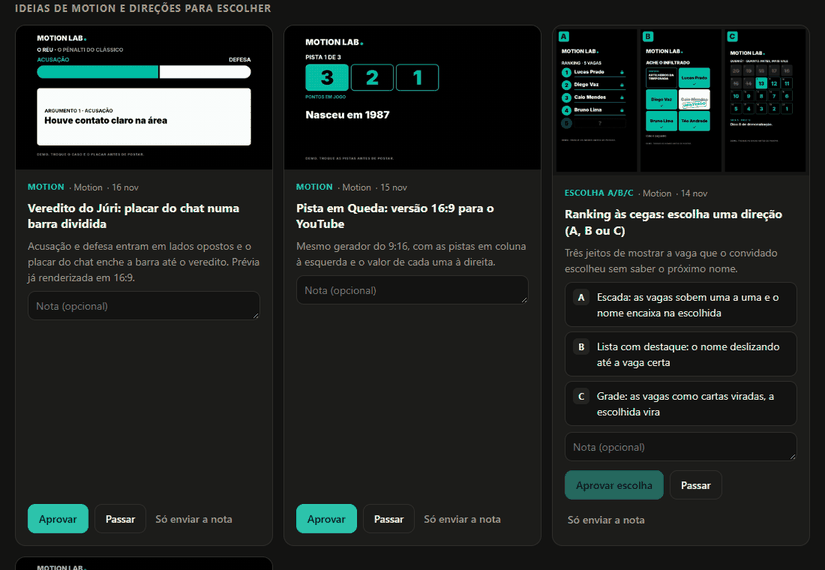
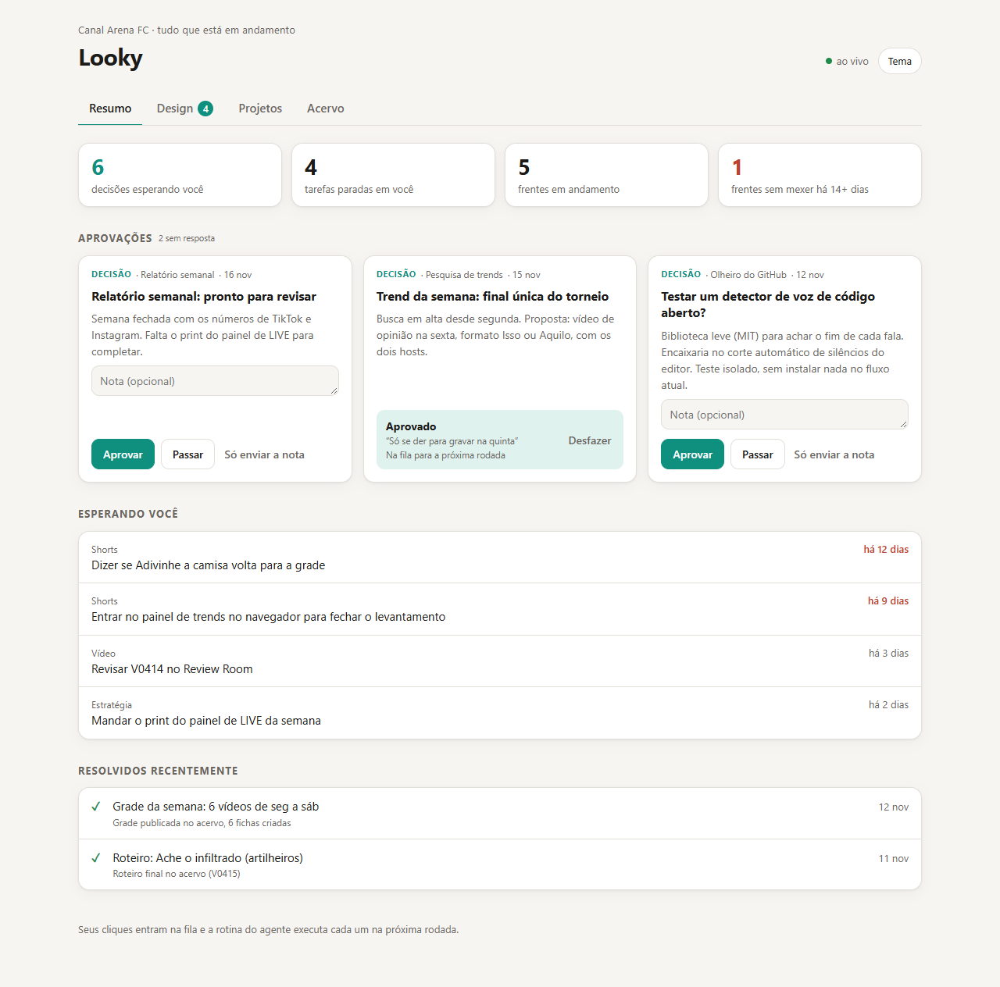
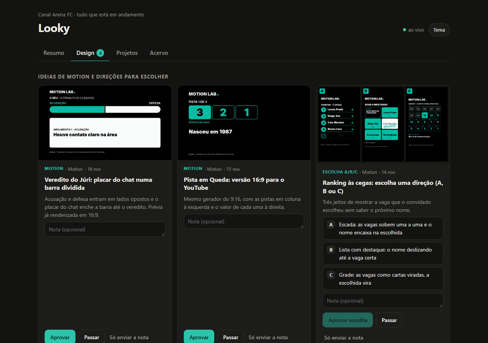
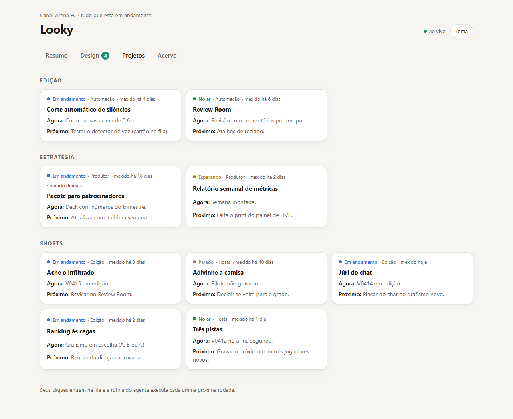
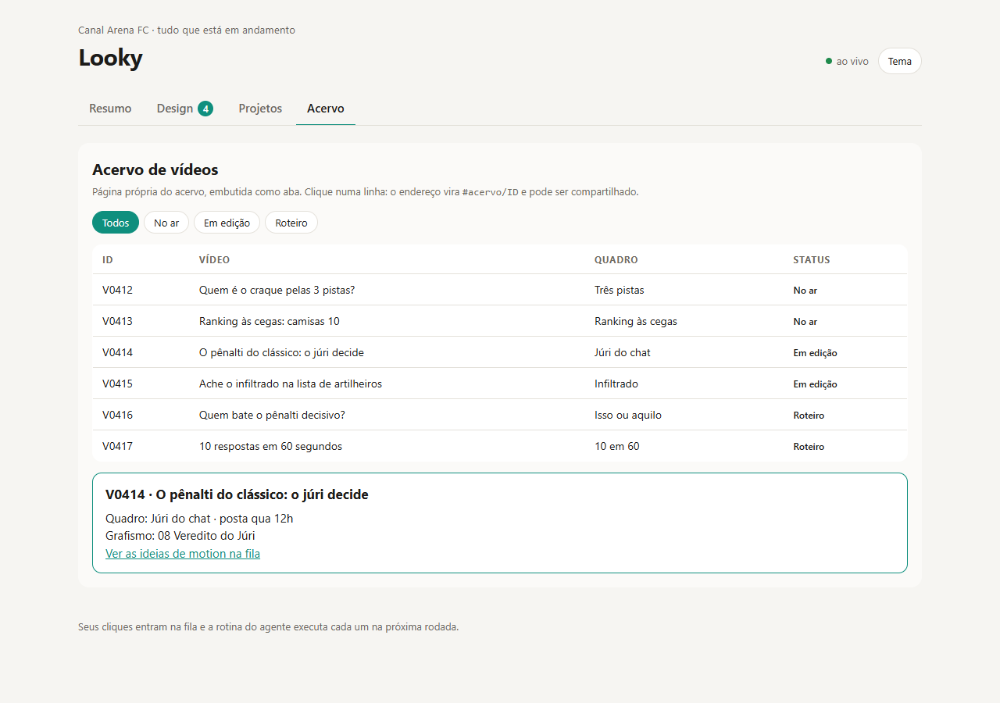
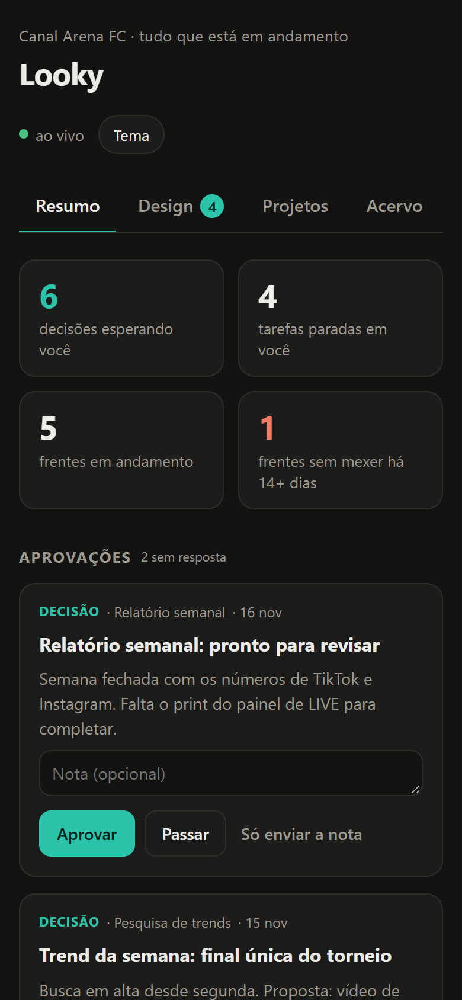

# Looky: painel de aprovação para um time que trabalha com agentes de IA

Quando boa parte do trabalho é feita por agentes (Claude Code) rodando em várias conversas, o gargalo vira a pessoa que precisa dizer **sim**. As perguntas se espalham por dezenas de chats, a resposta se perde e ninguém sabe o que está parado esperando quem.

A Looky junta tudo num lugar só. Toda decisão vira um **cartão** com prévia (GIF, imagem, opções A/B/C). O produtor aprova, passa ou deixa uma nota. O clique entra numa **fila**, e a rotina diária do agente executa cada item, marca como feito e atualiza o painel **ao vivo**.



> Os dados, o canal "Arena FC" e os nomes são fictícios. As prévias de motion vêm do meu outro projeto, `motion-graphics-programatico`.

## Como funciona

```
 conversas do agente ──► card add ──►┐
                                     │      ┌──────────────┐   clique   ┌──────────┐
 rotina diária (9h) ──► stream/wait ─┼────► │  looky.db    │ ◄───────── │  página  │
                                     │      │  (SQLite)    │ ─────────► │ ao vivo  │
 rotina diária ◄── queue / done ◄────┘      └──────────────┘  mudanças  └──────────┘
                                                               a cada 2 s
```

1. **O agente pede, não pergunta.** Quando uma conversa precisa de um sim, ela cria um cartão pela CLI (`python looky.py card add ...`) em vez de perguntar no texto. Um hook carrega no começo de toda conversa nova um resumo de uma página (`looky.py brief`) com essa regra e com o estado atual.
2. **O produtor decide pelo painel.** Aprovar, passar, escolher A/B/C, deixar uma nota. Cada clique vira um documento na coleção `decisions` com `status: queued`, e dá para desfazer enquanto estiver na fila.
3. **A rotina executa.** Uma vez por dia o agente roda a [rotina](ROTINA.md). Ela começa por `looky.py queue`, faz o que cada cartão pede e fecha cada item com `looky.py done <id> "resultado"`. O cartão sai da tela e vai para "Resolvidos" com o resultado.
4. **O dia anterior em uma página.** O [`digest.py`](digest.py) resume as transcrições locais do Claude Code: o que foi pedido, os arquivos mexidos, o que foi decidido e o que ficou esperando. A rotina lê esse resumo, não as transcrições inteiras, e por isso a rodada sai barata.

## Destaques técnicos

- **Ao vivo sem WebSocket e sem dependências.** Toda escrita no banco ganha um número de revisão. A página pergunta "o que mudou desde a revisão N?" (`/api/changes?since=N`) e recebe só os documentos alterados, inclusive os apagados, que ficam como lápide. O agente escreve pela CLI no mesmo arquivo SQLite (WAL, `BEGIN IMMEDIATE`), e o painel mostra a mudança em até 2 segundos. Veja [`looky/store.py`](looky/store.py).
- **Páginas independentes como abas, isoladas em shadow DOM.** Qualquer HTML em `page/embeds/` vira uma aba ([`looky/embed.py`](looky/embed.py)). O CSS vai para um shadow root (`:root` vira `:host`), e o script roda com `document` e `location` trocados por um `Proxy` que aponta para o shadow root e para o trecho `#aba/...` do endereço. A página embutida não precisa mudar nada e continua abrindo sozinha. Links `#outra-aba/item` trocam de aba, e o tema claro/escuro é repassado.
- **A página só escreve decisões.** O servidor recusa escrita da página em qualquer outra coleção. Cartões, frentes e pendências vêm do agente. O servidor escuta só em `127.0.0.1` e limita o tamanho do corpo.
- **Não perde o que você está digitando.** Se chega uma atualização enquanto há uma nota sendo escrita, o redesenho espera o campo perder o foco.
- **Demonstração que não envelhece.** Datas como `"@-3"` no `seed.json` viram "3 dias atrás" ao carregar, então os contadores "há N dias" sempre fazem sentido.

## Telas

| Resumo (claro) | Design (escuro) |
|---|---|
|  |  |
| **Projetos**: frentes por área, com alerta de "parado demais" | **Acervo**: página independente embutida em shadow DOM |
|  |  |



## Como rodar

Requisito: Python 3.9+. Não precisa instalar nada.

```bash
python server.py --demo          # abre em http://localhost:8780 com os dados de demonstração
```

Em outro terminal, faça o papel do agente e veja o painel mudar sozinho:

```bash
python looky.py queue
python looky.py done trend-final-unica "Roteiro escrito e ficha criada no acervo"
python looky.py card add motion-teste --kind motion --title "Teste: cartão novo" --image media/06-relogio-10-em-60-16x9.gif
python looky.py brief
python digest.py 2026-11-15 --dir demo/sessoes
```

O banco padrão é `looky.db` na raiz. Use `--db` ou a variável `LOOKY_DB` para apontar outro.

## Estrutura

```
server.py            servidor HTTP (só biblioteca padrão): página, arquivos e API JSON
looky.py             CLI do agente: card, queue, done, stream, wait, brief, seed
looky/store.py       documentos JSON por coleção em SQLite, com revisão e lápides
looky/embed.py       páginas independentes como abas em shadow DOM
looky/cli.py         comandos e o resumo para o hook
page/index.html      o painel (HTML, CSS e JS sem framework)
page/embeds/         cada .html aqui vira uma aba
digest.py            resumo diário das transcrições do Claude Code
ROTINA.md            texto da tarefa agendada e do hook SessionStart
demo/                dados e transcrições fictícios
```

## Resultado e minha parte

- **Em uso todo dia desde outubro de 2026** num canal de futebol com três apresentadores. Nesse período foram mais de 30 resumos diários, revisões semanais e dezenas de passagens de conversa longa para conversa nova.
- **Todo sim num lugar só:** ideias de motion (com GIF e opções A/B/C), trends para gravar, testes de ferramentas, relatórios e grades da semana. O fluxo de aprovação dos grafismos do `motion-graphics-programatico` passava inteiro por aqui.
- **Conversas novas começam informadas:** o resumo carregado pelo hook evita reexplicar o contexto a cada chat e reduz a releitura de histórico, que é o que mais pesa no custo de conversas longas.

A ideia de partida (um painel de aprovações alimentado por um resumo diário das sessões) veio de um kit comercial de prompts para gestão de projetos com Claude Code. Construí em cima dele: cartões ao vivo gravados direto no banco pelas conversas, a aba Design com escolha A/B/C, frentes e pendências ao vivo, e o acervo, os roteiros, os OKRs e a agenda embutidos como abas em shadow DOM. **Para este repositório reescrevi tudo do zero**, sem nenhum arquivo do kit: servidor, banco com feed de revisões, página, CLI, digest e embutidor de abas. A versão em produção roda como um artefato do claude.ai com o banco da própria plataforma. Esta roda em qualquer máquina, só com Python.

## English summary

Looky is an approval panel for a team whose work is largely done by AI agents (Claude Code). Every decision an agent needs becomes a card with a preview (GIF, image, A/B/C options). The producer approves, passes or leaves a note, and the click goes into a queue. A daily agent routine executes each item, marks it done and the panel updates live. It runs on the Python standard library only. The backend is a SQLite document store with a revision feed (`/api/changes?since=N`, tombstones for deletes) shared by the HTTP server and the agent's CLI, and the browser polls it every 2 seconds. Independent HTML pages become tabs isolated in shadow DOM, with `document` and `location` swapped for a `Proxy`, so they need no changes. `digest.py` turns the day's local Claude Code transcripts into a one-page summary so the routine stays cheap. The production version has been in daily use since October 2026. The starting idea came from a commercial prompt kit, and this repository is a from-scratch rewrite that contains none of its files.

## Licença

[MIT](LICENSE).
